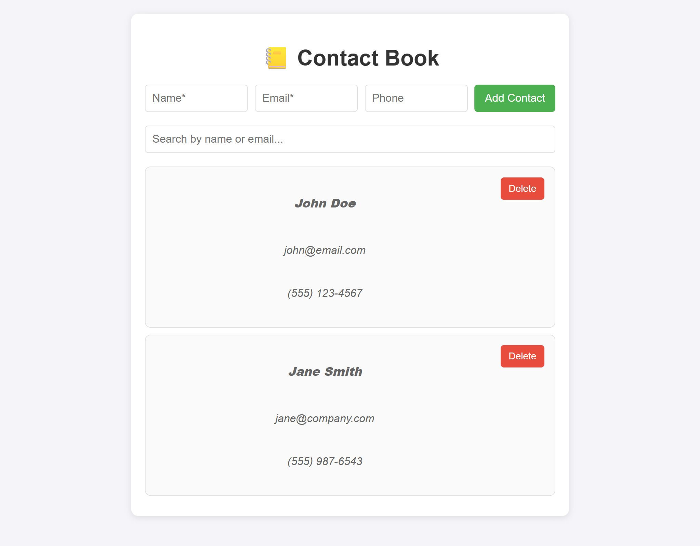

# Contact Book

A small contact manager built with React and Vite. Add people with a name, email and optional phone number, search them by name or email, and delete them. Your contacts are saved in your browser, so they are still there after a refresh.

**Live demo:** https://mberry-dev.github.io/contact-book/
Contacts are stored only in your own browser (localStorage). Nothing is sent to a server.



## Features

- Add contacts with validation: name and email are required, the email must look valid, and the same email can't be added twice (case is ignored)
- Live search by name or email
- Phone numbers with 10 digits are shown as (555) 123-4567
- Contacts are saved in the browser and reloaded on the next visit; damaged or blocked storage is handled without crashing
- Responsive layout (desktop, tablet and phone screenshots are in `contactbook/screenshots/`)
- Accessible labels on every input and delete button

## Run Locally

You need [Node.js](https://nodejs.org) 18 or newer.

```bash
git clone https://github.com/mberry-dev/contact-book.git
cd contact-book/contactbook
npm install
npm run dev
```

Then open the address shown in the terminal (usually http://localhost:5173).

## Tests

32 automated tests (Vitest and React Testing Library):

- **Unit tests** for the helpers: email validation, phone formatting, search, duplicate detection, and saving/loading including bad or blocked storage
- **App tests** that use the real interface: adding, rejecting duplicates and bad emails, searching, deleting, and that contacts survive a reload

```bash
npm test
npm run lint
npm run build
```

`npm test` prints one line per test file. To see every test listed by name, run:

```bash
npx vitest run --reporter=verbose
```

## Project Structure

```
contact-book/
├── .github/workflows/deploy.yml   # Builds and publishes the live demo
└── contactbook/
    ├── src/
    │   ├── App.jsx                # State, saving, search
    │   ├── components/            # ContactForm, ContactList, ContactItem, SearchBar
    │   └── utils/contacts.js      # Validation, formatting, search, storage helpers
    ├── tests/                     # Unit and app tests
    └── screenshots/
```

## Background

Built as a React practice project and later cleaned up, tested and deployed as part of my portfolio.
